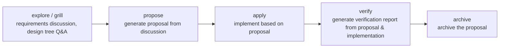

# OpenSpec (Fork / Enhanced)

> AI-assisted specification-driven development workflow. **Based on official skills with key improvements.**

**English** | **[繁體中文](README.zh.md)**

## Differences from Official Version

| Area                               | Official                           | This Fork                                               |
| ---------------------------------- | ---------------------------------- | ------------------------------------------------------- |
| **Reverse Questioning & Q&A Tree** | N/A                                | **Added openspec-grill with Q&A integration**           |
| **Custom Verification**            | Not supported                      | **`VERIFY.md`** — declarative, scope-aware              |
| **Glossary**                       | Not supported                      | **`GLOSSARY.md`** — project + change-level domain terms |
| **Nested Specs & Local `SPEC.md`** | Flat spec IDs only                 | **Nested capability specs + local `SPEC.md`** synced via `openspec-sync-specs` |
| **Store/Registry Support**         | Full (`--store`, `openspec store`) | Removed — no store registration required                |

---

## Installation & Setup

Install with the [`skills`](https://github.com/vercel-labs/skills) CLI. It copies every skill under `skills/` into each agent's own skills directory.

1. **Install the enhanced skills**:
   ```bash
   npx skills add s16777216/openspec-improve
   ```
   - Add `-g` to install globally instead of per-project; add `-a <agent>` (for example `-a claude-code -a codex`) to skip the interactive agent selection.
2. **Ask your agent to run the setup skill**: `openspec-setup` (Codex: `$openspec-setup`). It is safe to run again at any time. It:
   - checks the OpenSpec CLI and offers to install it (`npm install -g @fission-ai/openspec@latest`);
   - runs `openspec init --no-animation --tools none` if `openspec/` does not exist;
   - creates `openspec/VERIFY.md` and `openspec/GLOSSARY.md` from the [Starter Template Specifications](#templates) if they are missing.

   It asks for confirmation before each step and never overwrites an existing file. `openspec-status`, `openspec-new-change`, `openspec-propose`, and `openspec-onboard` also suggest `openspec-setup` when one of these files is missing.
   - **Windows users**: If PowerShell blocks `openspec` due to execution policy, the agent uses `openspec.cmd` instead.

The repo root also carries a spec-compliant `plugin.json`, so clients that follow the [Agent Plugins spec](https://agent-plugins.org/) can load it directly from this repository. `npx skills add` above remains the primary, recommended way to install into Claude Code or Codex.

---

### <a id="templates"></a> Starter Template Specifications (VERIFY.md & GLOSSARY.md)

`openspec-setup` creates `openspec/VERIFY.md` and `openspec/GLOSSARY.md` under `openspec/` if they do not exist. The starter templates and creation rules are defined in [`skills/openspec-setup/SKILL.md`](skills/openspec-setup/SKILL.md) — that file is the source of truth.

---

## Core Improvements

### 1. Openspec-Status

**Quick status overview** — `openspec-status`

A **concise overview** of all active OpenSpec changes, showing:
- Each change's stage (ideation/in-progress/ready-for-review)
- Task progress (e.g. 3/7 tasks)
- Next action and blockers
- Single recommended next step

**Example output:**
```
## OpenSpec Status

3 active changes:

### add-auth-flow — "OAuth login for the API"
- Stage: in-progress  •  Progress: 3/7 tasks
- Next: task 4 "Wire up refresh token rotation"

### fix-db-migration — "Repair flaky migration ordering"
- Stage: ready-for-review  •  Progress: 7/7 tasks
- Next: run `openspec-verify-change fix-db-migration`
```

Perfect for your morning "what's in flight?" check.

---

### 2. Openspec-Grill (Integration & Enhancement of grill-me)

#### New Features

- **Reverse Questioning** — proactively clarifies requirements before starting
- **Q&A Tree** — structured, traceable discussion flow
- **Specs Awareness** — directly references and discusses spec files
- **Design Tree Integration** — auto-generates `design.md`
- **State Tracking** — records Q&A state to avoid repetition

#### Output Results

After discussion completes, automatically generates:
- `design.md` — structured design decisions
- `tasks.md` — executable task list
- `specs/` — spec file updates (if needed)

---

### 3. VERIFY.md — Declarative Custom Verification

Per-repo, scope-aware shell commands that run as a supplement to the built-in completeness/correctness/coherence checks. Project-level and change-level files are additive — both run, merged in the report. Format, detection order, and scope-matching rules are defined in [`skills/openspec-verify-change/SKILL.md`](skills/openspec-verify-change/SKILL.md) (step 8) — that file is the source of truth.

---

### 4. GLOSSARY.md — Domain Terminology Registry

Central registry for project-specific terms (jargon, abbreviations, domain vocabulary), as a `term + definition + aliases` list. Project-level `openspec/GLOSSARY.md` is the single source of truth; change-level files are additive:
- **Create (grill)**: `openspec-grill` detects project-specific terms during the conversation, confirms definitions + aliases with the user, then writes them to `openspec/changes/<name>/GLOSSARY.md`
- **Archive**: `openspec-archive-change` merges the change-level `GLOSSARY.md` into project-level `openspec/GLOSSARY.md` — new terms appended, existing terms overwritten — then deletes the change-level file. Merge rules are defined in [`skills/openspec-archive-change/SKILL.md`](skills/openspec-archive-change/SKILL.md) (step 5) — that file is the source of truth.

> **Warning: `openspec init` overwrites fork extensions.**
> The official `openspec init` does **not** understand this fork's extensions (GLOSSARY, VERIFY). Running it with a tool selection rewrites the skills back to the official versions, wiping out GLOSSARY/VERIFY integrations. `openspec-setup` avoids this by using `--tools none`.
> **If you ever run `openspec init` with a tool selection, restore the skills immediately by running `npx skills add s16777216/openspec-improve` again.**

---

### 5. ASD-STE100 Writing Style

`openspec-propose`, `openspec-continue-change`, `openspec-ff-change`, and `openspec-update-change` write artifact prose in [Simplified Technical English (ASD-STE100)](https://www.asd-ste100.org/) style, so that each sentence has only one reading.

- Short sentences, active voice, commands for tasks
- One word, one meaning — terms follow project- and change-level `GLOSSARY.md`
- `MUST` / `MUST NOT` for obligations; measurable values instead of vague words
- Technical names, templates, and OpenSpec structure stay unchanged

**Languages:** the artifact keeps the language of the request. English follows ASD-STE100 directly. For other languages the language-neutral rules apply, which is not formal ASD-STE100. The rules are prompt instructions only; nothing checks compliance automatically.

---

## Skills (Agent Workflows)



### <a id="command-reference"></a> Complete Command Reference

| Skill | Description |
| :--- | :--- |
| `openspec-setup` | Set up OpenSpec in a project: CLI check, `openspec init`, starter `VERIFY.md` and `GLOSSARY.md` |
| `openspec-status` | Quick overview of all active changes and next steps |
| `openspec-explore` | Think through problems before/during work |
| `openspec-grill` | Design tree questioning to sharpen decisions |
| `openspec-new-change` | Start a new change, step through artifacts one at a time |
| `openspec-continue-change` | Continue working on an existing change |
| `openspec-ff-change` | Fast-forward: create all artifacts at once |
| `openspec-propose` | Create a change and generate all artifacts |
| `openspec-update-change` | Revise existing planning artifacts and keep them consistent; no code edits |
| `openspec-apply-change` | Implement tasks from a change |
| `openspec-verify-change` | Verify implementation matches artifacts |
| `openspec-sync-specs` | Sync main specs and refresh local SPEC.md from implemented code |
| `openspec-archive-change` | Archive a completed change |
| `openspec-bulk-archive-change` | Archive multiple completed changes at once |
| `openspec-onboard` | Guided onboarding through a complete workflow cycle |

---

### Revising an Existing Plan

Use `openspec-update-change <change-name>` (Codex: `$openspec-update-change <change-name>`) when requirements change, grill/explore yields new decisions, or existing planning artifacts contradict one another. It proposes revisions to existing artifacts for user confirmation; it does not create missing artifacts or edit implementation code.

Fork integration includes confirmed grill/explore decisions and terminology checks against project- and change-level `GLOSSARY.md`. It can propose edits to an existing change-level glossary and `VERIFY.md` when the revised plan affects terms or verification scope. Project-level files remain read-only; verification settings are additive, and checks run through `openspec-verify-change`, not update. Missing extension files are reported as deferred setup rather than created automatically.

Use `openspec-continue-change` or `openspec-ff-change` for missing artifacts, `openspec-apply-change` to implement the revised plan, and `openspec-sync-specs` to merge delta specs into main specs. The terminal command `openspec update` separately refreshes generated skills from the installed CLI.

## Directory Structure

```
openspec/
├── changes/
│   └── add-user-auth/
│       ├── .openspec.yaml
│       ├── proposal.md
│       ├── specs/
│       │   └── identity/authentication/spec.md
│       ├── design.md
│       ├── tasks.md
│       ├── VERIFY.md          # change-level (additive)
│       └── GLOSSARY.md        # change-level terms (merged at archive)
├── specs/
│   └── identity/authentication/spec.md  # main spec
├── VERIFY.md                  # project-level
└── GLOSSARY.md                # project-level (single source of truth)
```

The path below `specs/` is the capability ID. Organize new specs by business domain and capability (for example, `identity/authentication`). A proposal uses the **same relative path** for its delta spec and creates files only for capabilities it changes. An existing flat ID such as `auth` remains valid; reuse that ID when modifying its spec. Keep requirements and scenarios inside the capability's `spec.md`, rather than making a directory per requirement.

Specs describe behavior across repositories. Do not label a behavioral `spec.md` as belonging to one code repository. Record the repositories and implementation locations for a change in its `design.md`; place repository-specific checks in `VERIFY.md`.

### Local `SPEC.md` alongside central specs

Use `SPEC.md` as a short **folder guide**: it lets an agent quickly learn what a directory contains and what it is for. Each file describes only its own directory (about 30 lines at most). A repo/module root always gets one; another directory gets one only when it has a distinct responsibility its parent's one-line entry cannot convey, and the user approves it. Agents read only the `SPEC.md` of the directories they work in (plus parents), so context stays small. Creating or modifying any `SPEC.md` requires user approval.

| Document | Responsibility |
| --- | --- |
| `openspec/specs/<capability-id>/spec.md` | Canonical behavior: requirements and scenarios, independent of implementation repos. |
| `openspec/changes/<name>/specs/<capability-id>/spec.md` | Proposed change to that behavior. |
| `openspec/changes/<name>/design.md` | Repos, modules, and implementation decisions for this change. |
| `<dir>/SPEC.md` | Folder guide: purpose, one-line contents, and the capability IDs implemented here with links to their central specs. No flows, numeric limits, versions, or test lists. |

Example at an API repo root:

```markdown
# api

## Purpose
HTTP API: login, sessions, and user data.

## Contents
- `src/auth/` - login and session handling (see `src/auth/SPEC.md`)
- `src/routes.ts` - route registration
- `src/db.ts` - database access

## Capabilities
- `identity/authentication` - `openspec/specs/identity/authentication/spec.md` in the spec repo
```

Apply records affected local `SPEC.md` paths as pending sync notes in the change artifacts. `openspec-sync-specs` integrates main specs and, after the user approves each proposed file, refreshes local `SPEC.md` files from actual code (only for directories the change touched). Unimplemented or inaccessible portions remain pending; a later sync revisits them even if main specs are already current. Verification reports pending integration separately from implementation failures, and archive uses the same sync workflow. Resolve pending entries before normal archival; archiving with outstanding updates requires explicit confirmation with warnings.

Keep requirement and scenario text in the central spec, so a change has one behavioral source of truth. A local file can reference `identity/authentication` even when the central `openspec/` directory lives in another repo.

---

## Compatibility

- **OpenSpec CLI**: The existing flat workflow was tested against **1.8.0**. Nested spec discovery and matching were checked with **1.13.0**; use that version or verify your installed CLI supports nested specs before adopting the new layout.
- **Platforms**: macOS, Linux, Windows (use `openspec.cmd` on Windows if PowerShell execution policy blocks `.ps1` shims).

---

## Contributing

Want to add a new workflow skill or run the project's consistency checks? See [CONTRIBUTING.md](CONTRIBUTING.md).

---

## License

[MIT](LICENSE)
